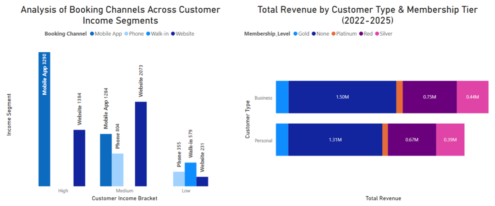
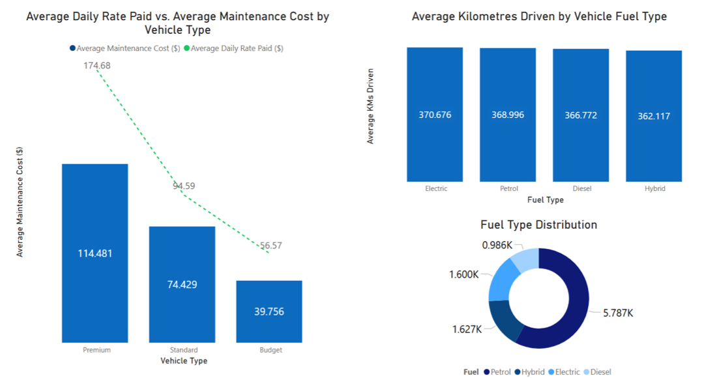
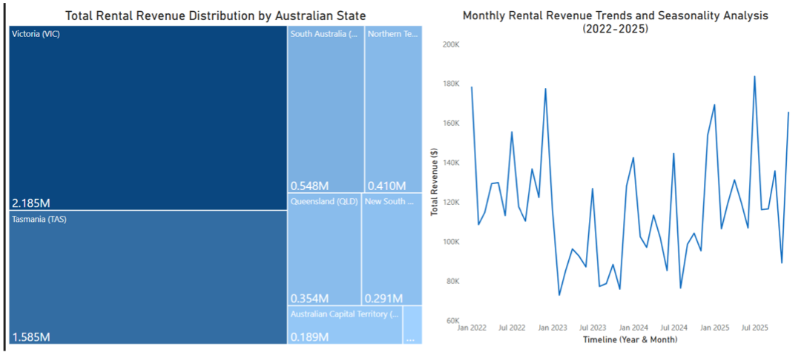
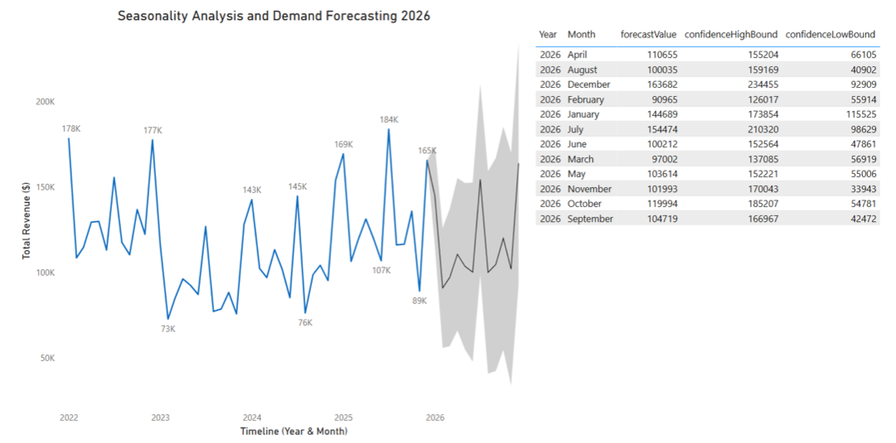

<div align="center">

# 🚗 Car Rental Analytics & 2026 Demand Forecasting
### Customer Behavior · Fleet Cost · Seasonality · Time-Series Forecasting (Australia)


</div>

---

## 📌 Business Problem

An Australian car rental company operating in multiple states wants to **understand its customers, control fleet costs, find its strongest markets and forecast 2026 revenue** so it can plan pricing, investment and fleet availability.

## 🎯 Key Insights at a Glance

| | Insight |
|---|---|
| 📱 **Mobile App + Website** | Dominant booking channels for high- and medium-income customers |
| 🏷️ **"None" membership** | Generates most of the revenue, so the loyalty program is underused |
| 🔧 **Premium cars** | Highest daily rate ($174.68), but also the highest maintenance cost ($114.48) |
| 🗺️ **VIC + TAS** | Lead revenue ($2.19M + $1.59M); NSW underperforms despite Sydney's size |
| 📅 **Seasonality** | Peaks every **December** (Christmas) and dips every **July** (winter) |
| 🔮 **2026 Forecast** | ~$145K in January, $91–97K in Feb–Mar, and a **$164K peak in December** |

## 📊 Analysis

### 1. Customer Behavior Analysis


- High-income customers book mostly through the **Mobile App (3,290)** and the **Website (1,384)**.
- Low-income customers prefer traditional channels such as **walk-in**.
- Most revenue comes from customers **without a membership**, a clear opportunity to **strengthen the loyalty program**.

### 2. Fleet Management & Cost Analysis


- **Premium and Standard** vehicles bring the highest daily rates *and* the highest maintenance costs. Revenue alone is a trap, so **margin matters**.
- **Budget** vehicles earn the least per day but return strong profit **per dollar spent**.
- **Electric** vehicles are driven the most km on average, even though the fleet is mostly petrol. Investing in **EV and hybrid** cars can lower future costs.

### 3. Geographical & Seasonal Performance


- **Victoria** and **Tasmania** are the core markets, so customer satisfaction there is critical.
- **NSW** revenue is low relative to its population and needs a new growth strategy.
- Revenue follows a clear **seasonal cycle**: a December peak and a July trough.

### 4. Seasonality Analysis & Demand Forecasting for 2026


Revenue for 2026 was forecast with Power BI's **ETS (Exponential Smoothing) time-series model** with seasonality enabled. The shaded band shows the confidence interval. Monthly forecasts are available in [`data/revenue-forecast-2026.csv`](data/revenue-forecast-2026.csv).

## 💡 Strategic Recommendations

1. **Dynamic pricing** in peak periods (Christmas and New Year) instead of fixed rates.
2. **Corporate leasing** during slow months to keep cash flowing.
3. **Schedule maintenance in low season** so the whole fleet is available at peak.
4. **Shift investment** towards high-performing states (VIC and TAS) and EV/hybrid vehicles.
5. **Use new technologies**: IoT and AI sensors for predictive maintenance, and AI agents in booking channels to improve customer satisfaction.

## 🗂️ Dataset

10,000 rental transactions × 25 features: booking date, customer, vehicle brand, type and fuel, city and state, base and daily rate, rental days, km driven, damage, customer demographics, membership level, income bracket, maintenance cost and booking channel.

## 📁 Repository Structure

```
├── dashboard/   car-rental-dashboard.pbix            → Interactive Power BI dashboard
├── report/      car-rental-forecasting-report.pdf    → Full analysis report
├── data/        car-rental-dataset.csv               → Raw dataset (10,000 rows)
│                revenue-forecast-2026.csv            → ETS forecast output with confidence bounds
└── images/                                           → Visuals used in this README
```

## 🚀 How to Explore

1. Download [`dashboard/car-rental-dashboard.pbix`](dashboard/car-rental-dashboard.pbix) and open it with **[Power BI Desktop](https://powerbi.microsoft.com/desktop/)** (free).
2. Or read the [📄 PDF report](report/car-rental-forecasting-report.pdf).

## 🛠️ Skills Demonstrated

`Time-Series Forecasting (ETS)` · `Seasonality Analysis` · `Cost–Revenue Analysis` · `Customer Segmentation` · `Geospatial Analysis` · `Power BI` · `Strategic Recommendations`

---

<div align="center">

👥 Group project for the Master of Data Analytics program, with contributions by **Yasin Topal**

⭐ If you found this project interesting, consider giving it a star!

</div>
